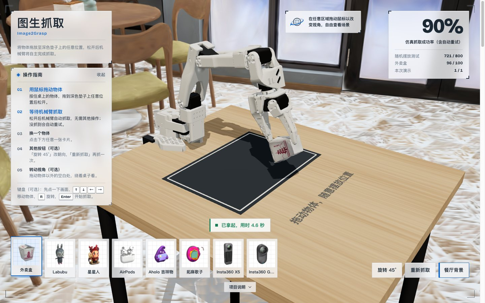

# 图生抓取 · Image2Grasp

从几张商品图片，到一只会自己抓东西的机械臂。用 Aholo Lux3D 把 8 个真实物品生成为 3D 模型，放进 MuJoCo 物理仿真，以一台真实的 SO-101 机械臂遥操作采集 340 次抓取示范，再训练出一个不看图像的抓取模型。模型和物理仿真都在浏览器里运行，不需要服务器算力。

**在线演示：** [魔搭创空间 liulhs/image2grasp](https://www.modelscope.cn/studios/liulhs/image2grasp)

[Aholo 全球 3D AI 黑客松 2026](https://www.aholo3d.cn/hackathon) 参赛作品 · Team ManiForge



## 演示怎么玩

1. 用鼠标按住桌上的物体，拖到深色垫子上任意位置后松开。
2. 机械臂自动伸手抓取；没抓到会退回起点，从物体当前位置重试，最多再试 3 次。
3. 点击下方卡片换一个物体，或者拖动物体以外的空白处转动视角。

首次打开约下载 50 MB（物理引擎、推理引擎、模型和一个物体的场景），之后切换物体每个再下 11–14 MB。

## 做了什么

| 步骤 | 内容 | 代码 |
| --- | --- | --- |
| 1. 生成物体 | 每个物体以 1–8 张不同角度的图片作为 Lux3D 图生 3D 的输入；只有一张正面图时，先用 Lux3D 的「AI 多视图补全」补出四个视角。 | [experiments/2026-11-18-lux3d-objects](experiments/2026-11-18-lux3d-objects/README.md) |
| 2. 导入仿真 | 模型缩放到夹爪能抓的大小，生成凸包碰撞体并压平底面，设 30–60 克的质量和摩擦，放进 MuJoCo。机械臂是 MuJoCo Menagerie 的 SO-101。 | [sim/prep_object.py](sim/prep_object.py) · [sim/lift_scene.py](sim/lift_scene.py) |
| 3. 遥操作 | 用手带动一台真实的 SO-101，仿真里的 SO-101 实时跟随它的关节角度，看着屏幕在仿真里抓。 | [sim/teleop.py](sim/teleop.py) · [sim/README.md](sim/README.md) |
| 4. 采集示范 | 每个物体在随机位置采集 40 次（外卖盒 60 次），共 340 次、36,497 帧。物体抬起 5 厘米并保持 1 秒记为成功，失败的回合不保存。每帧保存完整物理状态，可以原样回放。 | [sim/record.py](sim/record.py) · [sim/replay.py](sim/replay.py) |
| 5. 训练 | ACT（LeRobot 0.7.0），740 万参数。每帧输入 18 个数：6 个关节角，加物体重心位置、朝向和尺寸 12 个数；输出未来 2 秒的 40 步关节目标，逐帧预测后加权平均。8 个物体共用一个模型，在一台 Mac 上训练 40,000 步，约 30 分钟。 | [sim/build_state_dataset.py](sim/build_state_dataset.py) · [sim/evaluate.py](sim/evaluate.py) |
| 6. 浏览器 | 物理用 MuJoCo 官方 WebAssembly 版，模型导出为 ONNX 由 onnxruntime-web 在 CPU 上运行，three.js 渲染，每秒 20 帧，单帧约 2 毫秒。餐厅背景是 SAGE-3D / InteriorGS 的高斯泼溅场景，只用于显示。 | [web/](web/README.md) · [sim/export_policy.py](sim/export_policy.py) |

## 结果

按网页的设置（机械臂固定起始姿态，物体在垫子上随机位置、随机朝向），每个物体 100 次，共 800 次：

| | 不重试 | 含重试（网页现在的设置） |
| --- | --- | --- |
| 物体位置用底面中心 | 614 / 800（77%） | 655 / 800（82%） |
| **物体位置用重心** | 671 / 800（84%） | **721 / 800（90%）** |

含重试时各物体：外卖盒 96、Aholo 吉祥物 95、Insta360 GO 3S 93、星星人 92、Labubu 91、Insta360 X5 86、拓麻歌子 85、AirPods 83（每个 100 次）。

成功率由网页的同一套代码在 Node 里批量测得（[web/tools/eval_browser.ts](web/tools/eval_browser.ts)）；在 Chrome 里抽查同样摆放的 200 次，抓起 178 次，Node 里是 184 次。逐步改进的过程和诊断见 [web/README.md](web/README.md) 和 [sim/README.md](sim/README.md)。

## 局限

- 抓取全部在仿真中完成。真实机械臂只用作遥操作主臂，模型还没有在真实机械臂上部署。
- 失败几乎都是物体先被碰倒。示范里物体都是立着的，模型很少见到倒在桌上的物体。
- 仿真物体比实物小：Labubu 实物高 18 厘米，仿真中约 10 厘米，以适配 SO-101 夹爪的开合范围。

## 本地运行网页

```bash
cd web
npm install
npm run dev        # http://localhost:5173
npm test           # 单元测试
npm run build      # 静态站点输出到 web/dist/
```

仓库里有模型（`web/public/policy/`）和场景清单，但没有每个物体编译好的场景文件和餐厅背景（体积大，背景的许可也不允许随仓库再分发）。最简单的办法是从创空间的仓库里拷过来：

```bash
git lfs install
git clone https://www.modelscope.cn/studios/liulhs/image2grasp.git /tmp/image2grasp
cp /tmp/image2grasp/scenes/*.mjb.gz web/public/scenes/
mkdir -p web/public/background && cp /tmp/image2grasp/background/* web/public/background/
```

从头重建场景需要 Lux3D 的原始输出（`textured.glb`），它们没有放进仓库；流程见 [sim/README.md](sim/README.md) 和 [web/README.md](web/README.md)。

## 仿真与训练

Python 3.13 + MuJoCo 4.0.1 + LeRobot 0.7.0，在 macOS（Apple Silicon）上开发：

```bash
uv venv --python 3.13 .venv && source .venv/bin/activate
uv pip install -r sim/requirements.txt
bash sim/fetch_models.sh                 # 下载 MuJoCo Menagerie 的 SO-101
mjpython sim/teleop.py                   # 用真实 SO-101 遥操作仿真机械臂
mjpython sim/record.py --object labubu --episodes 40
python sim/build_state_dataset.py        # 合并成不含图像的数据集
```

训练、评估、导出 ONNX 和生成网页场景的完整命令见 [sim/README.md](sim/README.md)。

## 仓库结构

| 目录 | 内容 |
| --- | --- |
| [web/](web/README.md) | 网页演示：MuJoCo WebAssembly、onnxruntime-web、three.js |
| [sim/](sim/README.md) | MuJoCo 场景、物体转换、遥操作、录制、训练数据、评估、导出 |
| [experiments/](experiments/) | Lux3D 生成记录（输入图片、参数、结果对比）和早期的 CPU 验证 |
| [hardware/](hardware/README.md) | SO-101 驱动板安装板的 STL 打印件 |
| [tools/](tools/) | SO-101 舵机扫描和编号、物理属性估计 |
| [cloud-setup/](cloud-setup/AWS-RUNBOOK.md) | 早期在 AWS 上跑 Isaac Sim + LeIsaac 的方案（后来改用 MuJoCo） |
| [gotchas/](gotchas/README.md) | 踩过的坑 |
| [NOTES.md](NOTES.md) | 比赛期间的开发记录，按时间保留了调研、实测和失败原因 |

[TECHNICAL.md](TECHNICAL.md)（Lux3D 输入输出与仿真先例）、[TRAINING-PLAN.md](TRAINING-PLAN.md)、[WEB-DEMO.md](WEB-DEMO.md) 和 [SO101-NEXT-STEPS.md](SO101-NEXT-STEPS.md) 是当时的调研文档。

## 许可与素材

- **代码：** [Apache License 2.0](LICENSE)。
- **3D 模型：** 由 Aholo Lux3D 生成，使用遵循 [Aholo 服务条款](https://www.aholo3d.cn/agreement/termsofuse)。
- **输入图片：** Labubu、星星人为泡泡玛特官网商品图；AirPods Pro 3 为 Apple 官网商品图；Insta360 X5、GO 3S 为 Insta360 官网商品图。版权归各公司所有，仅用作 Lux3D 的输入并在演示中展示，无商业用途。拓麻歌子来自 Wikimedia Commons（CC BY-SA 3.0），外卖盒来自 Wikimedia Commons（CC0），Aholo 吉祥物来自 Aholo3D 工作台。
- **餐厅背景：** 群核 SpatialVerse 的 [SAGE-3D_InteriorGS_usdz](https://huggingface.co/datasets/spatialverse/SAGE-3D_InteriorGS_usdz) 场景 839920（CC BY-NC 4.0），只用于非商业展示，不在本仓库中。
- **第三方：** [MuJoCo](https://mujoco.org) 与 [MuJoCo Menagerie SO-101](https://github.com/google-deepmind/mujoco_menagerie/tree/main/robotstudio_so101)（Apache-2.0），[SO-ARM100](https://github.com/TheRobotStudio/SO-ARM100)（Apache-2.0），[LeRobot](https://github.com/huggingface/lerobot)（Apache-2.0），[ONNX Runtime](https://onnxruntime.ai)、[three.js](https://threejs.org)、[Spark](https://sparkjs.dev)（MIT），[Bricolage Grotesque](https://fonts.google.com/specimen/Bricolage+Grotesque)（OFL）。ACT 方法见 [Zhao 等，RSS 2023](https://arxiv.org/abs/2304.13705)。
