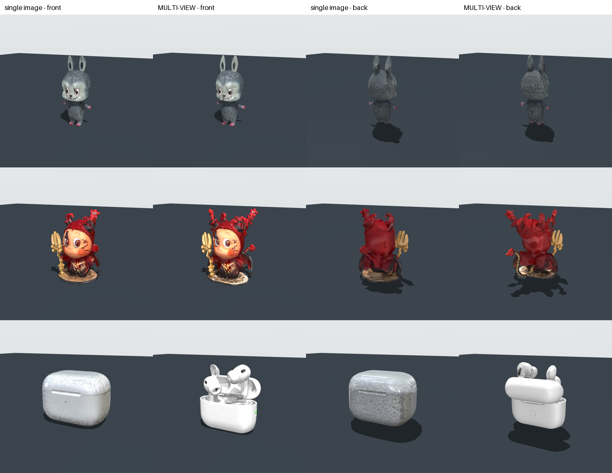
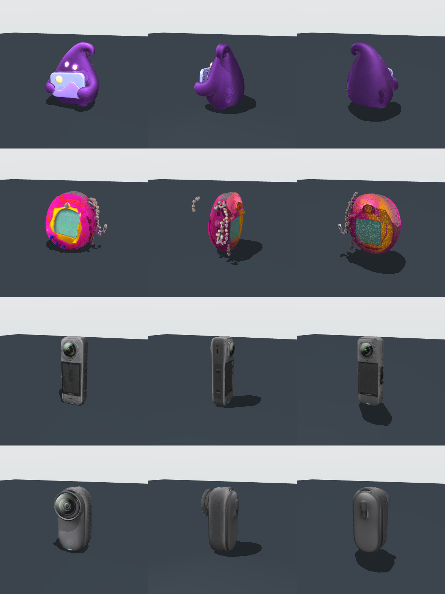
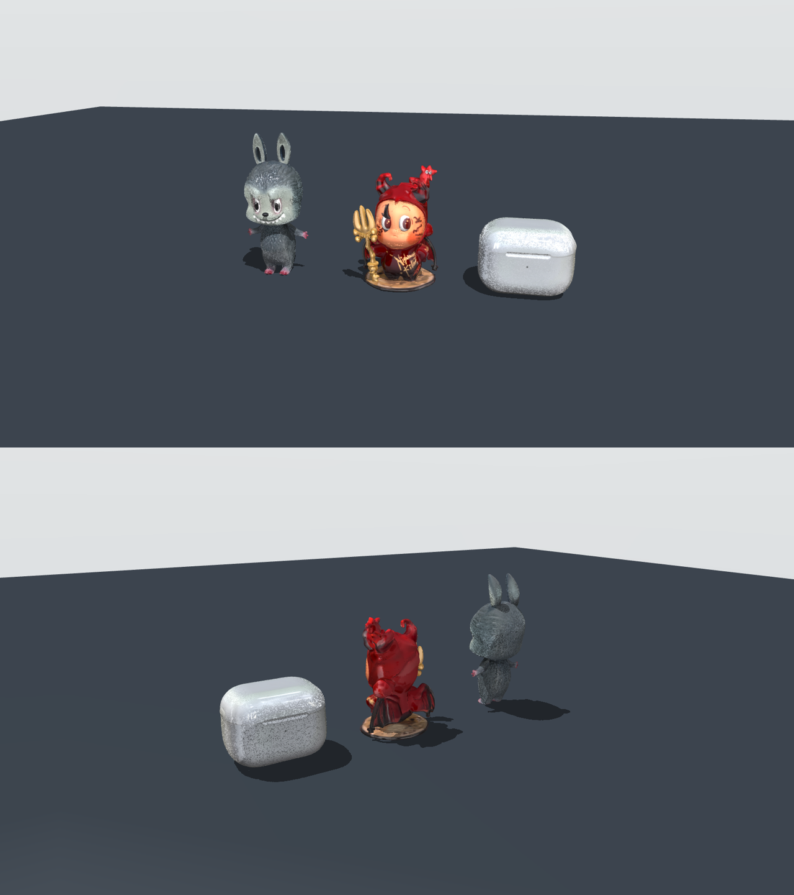

# 2026-11-18 · Lux3D 图生 3D：Labubu、星星人、AirPods、Aholo 吉祥物、拓麻歌子、Insta360 X5 和 GO 3S

**结论：** 一共七个新物体。前三个（Labubu、星星人、AirPods）各生成了两轮；后四个（吉祥物、拓麻歌子、X5、GO 3S）直接用多视角生成，见「第三轮」。前三个的情况：第一轮只传一张图，AirPods 很差（表面全是噪点，厚度是实物的两倍）。第二轮改用多视角输入，三个都更好，AirPods 改善最大。**后续用第二轮的结果**（`labubu_mv`、`twinkle_devil_mv`、`airpods_open_mv`）。都还没接进抓取场景，也没录示范。



每行一个物体。第 1、3 列是单图生成的正面和背面，第 2、4 列是多视角生成的正面和背面。

## 第二轮：多视角输入（采用）

Lux3D 的输入规格见 [TECHNICAL.md](../../TECHNICAL.md)「图生 3D 接受什么输入」。要点：可以传 1–32 张图，第一张是主图（决定材质），其余只当视角参考；只有一张图时可以先用「AI 多视图补全」补出四个角度。

| 物体 | 输入 | 任务 | 结果 |
| --- | --- | --- | --- |
| labubu_mv | 官网正面图 + AI 补全的 4 张（`input/labubu_views/`） | 补全 45068，生成 45073 | 和单图版接近，背面的毛发纹理更完整 |
| twinkle_devil_mv | 官网的正面、侧面、背面 3 张实拍白底图（`input/twinkle_devil_views/`） | 生成 45061 | 背面多了尾巴，翅膀和角的形状更准 |
| airpods_open_mv | Apple 官网 AirPods Pro 3 开盖正面图 + AI 补全的 4 张（`input/airpods_pro3_open_views/`） | 补全 45052，生成 45057 | 干净的白色，没有噪点；厚度正确；背面有转轴和按键。右侧有一小块绿色瑕疵 |

- **AirPods 换了主图：** 第一轮用的是 Commons 上从正上方拍的合盖照片，地面有反光。第二轮换成 Apple 官网的开盖商品图（影棚光线、白底）。这张图版权归 Apple。
- **没找到同一个充电盒的多角度实拍：** Commons 上都是开盖或耳机的照片；Best Buy 商品页打不开；Apple 官网图库里只有一张可用。所以 AirPods 和 Labubu 用的是 AI 补全的视角，只有星星人用的是三张真实照片。
- **消耗：** 两次补全加三次生成，用完了剩下的 2 次限免，积分从 2,100 降到 2,036（花了 64）。
- **耗时：** 补全约 1 分钟，生成各约 6 分钟，三个同时跑。

转换后的尺寸（宽 × 深 × 高）：labubu_mv 4.5 × 3.7 × 9.6 cm（23.5 万面），twinkle_devil_mv 5.5 × 5.0 × 7.9 cm（16.2 万面），airpods_open_mv 5.5 × 3.4 × 6.0 cm（21.8 万面）。

## 第三轮：再加四个物体（11/18 晚，采用）



每行一个物体，三列是正面斜侧、侧面、背面斜侧。

| 物体 | 输入 | 任务 | 结果 |
| --- | --- | --- | --- |
| aholo_mascot_mv | Aholo3D 工作台页面上的吉祥物大图（1254 px，透明底）+ AI 补全的 4 张（`input/aholo_mascot_views/`） | 补全 47833，生成 47870 | 好。正面的眼睛、图片卡片都对，背面是纯紫色，有少量色斑 |
| tamagotchi_mv | Commons 的 [Tamagotchi 0124 ubt.jpeg](https://commons.wikimedia.org/wiki/File:Tamagotchi_0124_ubt.jpeg)（CC BY-SA 3.0）+ AI 补全的 4 张（`input/tamagotchi_views/`） | 补全 47844，生成 47862 | 一般。正面可以，挂链生成成了一串碎块，背面错成了另一个屏幕。四个里最差 |
| insta360_x5_mv | Insta360 官网 X5 商品页的 360° 旋转序列图，取了 8 帧（`input/insta360_x5_views/`），是真实多角度 | 生成 47887 | 好。两个镜头、屏幕、侧面按键都对，屏幕上有少量噪点 |
| insta360_go3s_mv | Insta360 官网 GO 3S 单机透明底图 + AI 补全的 4 张（`input/insta360_go3s_views/`） | 补全 47893，生成 47903 | 好。镜头、机身纹理、背面按键都对 |

- **吉祥物补全的图左上角和左下角带着「Q1」到「Q4」的字样**，是模型自己画上去的。上传前把这两个角涂白了，否则可能被当成物体的一部分。
- **提交生成要等十几秒才生效。** 点「生成 3D 模型」后马上点「新建任务」，任务会被取消，而且没有任何提示。X5 和吉祥物第一次就是这样丢的，后来每次都到任务列表接口（`/api/lux3d/editor/generation-tasks`）确认任务出现了再做下一个。
- **消耗：** 三次补全加四次生成，积分从 2,036 降到 1,884（花了 152）。
- **来源和版权：** 吉祥物是主办方 Aholo 自己的形象；拓麻歌子是万代的产品，照片是 CC BY-SA 3.0，报告里要署名；X5 和 GO 3S 是 Insta360 的官网商品图，版权归 Insta360（Insta360 是这次比赛的生态伙伴）。
- **拓麻歌子如果要改善：** 换一张没有挂链的照片，或者先把挂链从图里去掉再生成。

转换后的尺寸（宽 × 深 × 高）：aholo_mascot 5.0 × 4.2 × 6.0 cm，tamagotchi 4.5 × 2.4 × 4.5 cm（宽度里包含挂链），insta360_x5 3.6 × 3.1 × 9.7 cm（实物 4.6 × 3.8 × 12.5 cm），insta360_go3s 3.5 × 3.6 × 7.0 cm（实物约 2.6 × 2.5 × 5.4 cm，这里放大了）。

## 第一轮：单张图输入（不再使用）

第一轮没有先查 Lux3D 的输入规格，每个物体只传了一张图。下面是当时的记录。



## 输入图片

| 物体 | 来源 | 许可 |
| --- | --- | --- |
| Labubu | 泡泡玛特美国官网 [LABUBU Original Ver.3 Figure](https://www.popmart.com/us/products/8990/labubu-original-ver.3-figure) 商品主图（白底，正面） | **官方商品图，版权归泡泡玛特**，没有授权。用户知情后决定使用 |
| 星星人 | 泡泡玛特美国官网 [Twinkle Twinkle Little Devil Star Figure](https://www.popmart.com/us/products/3620/twinkle-twinkle-little-devil-star-figure) 商品图（浅灰底，略侧） | 同上 |
| AirPods 充电盒 | Wikimedia Commons [AirPod pro.jpg](https://commons.wikimedia.org/wiki/File:AirPod_pro.jpg) | CC0 |

- 原图在 `input/source/`，`prep_inputs.py` 把物体裁成 1024×1024 的方图，放在 `input/`。
- **为什么用官方商品图：** 找过 Wikimedia Commons、Openverse（Flickr）。Commons 上的 Labubu 实物照已被删除，Flickr 上的要么禁止改编（BY-NC-ND），要么是招牌和店面。没有许可清楚、又适合生成的单体照片。
- **报告里要如实写**输入图片的来源；Labubu 和星星人是泡泡玛特的形象，赛事 FAQ 要求第三方内容取得合法授权。

## 生成

- **工具：** Aholo3D 网页工作台（`3d.aholo.cn/studio`）的图生 3D，用 Claude in Chrome 操作。
- **设置：** 默认值。`lux3d_g1`、`standard`、300K 面、PBR 贴图开启、不去背景。
- **任务：** 45003（Labubu）、45010（星星人）、45012（AirPods），同时提交，各用了约 6–7 分钟。
- **消耗：** 用了 3 次限免（5 次剩 2 次），积分没变，仍是 2,100。
- **产物：** 各自目录下的 `textured.glb`（12–20 MB），从 `qhsmodel.kujiale.com` 下载。这次没有拿到 `raw_mesh.glb`，同一路径下返回 404。

## 转成 MuJoCo 资产

`sim/prep_object.py`：缩放、转成 Z 轴朝上、底面落在 z=0，外观保留贴图，碰撞体用凸包。输出在 `sim/models/objects/<名字>/`（不进 git）。

| 物体 | 命令里的 `--grip-width` | 转换后尺寸（宽 × 深 × 高） | 面数 | 说明 |
| --- | --- | --- | --- | --- |
| labubu | 0.045 | 4.5 × 3.9 × 9.9 cm | 27.6 万 | 实物高 18 cm，这里缩小了约一半 |
| twinkle_devil | 0.055 | 5.5 × 4.5 × 7.9 cm | 26.6 万 | 带圆形底座和三叉戟 |
| airpods_case | 0.061 | 6.1 × 4.3 × 4.5 cm | 27.2 万 | 实物约 6.1 × 2.2 × 4.5 cm，生成的偏厚；表面有噪点 |

```bash
python sim/prep_object.py labubu experiments/2026-11-18-lux3d-objects/labubu --grip-width 0.045
```

## 还没做的

- **八个物体都已接进抓取场景**（`sim/prep_object.py` 的 `OBJECTS`），但都还没有用真臂录过示范，也没验证夹爪能不能夹起来。
- 第一轮和第二轮的单图版 `textured.glb`（`labubu/`、`twinkle_devil/`、`airpods_case/`）还留在这个目录里，确认不用后可以删。
- 外观网格每个 15–28 万面，放进网页前要减面。
- 这个目录现在约 170 MB，`textured.glb` 每个 12–20 MB，没超过 GitHub 的 100 MB 上限，但还没决定进不进 git。
