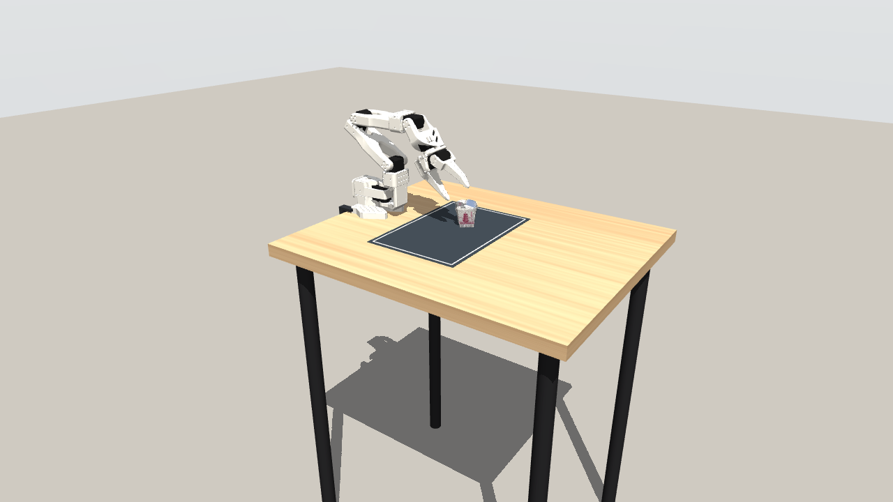
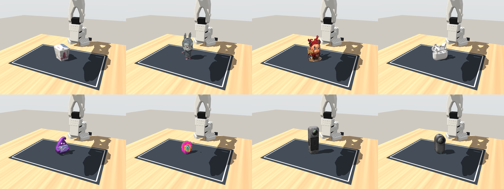

# MuJoCo 仿真：用真 SO-101 遥控仿真里的 SO-101

2026-11-16 搭建。这一步的目的：手掰真臂（臂 A，已经按主臂模式校准成 `arm_a`），MuJoCo 里的手臂跟着动。后面录示范、训练 ACT 都在这套环境里做，见 [TRAINING-PLAN.md](../TRAINING-PLAN.md)。

## 这套环境由什么组成

| 东西 | 位置 | 进不进 git |
| --- | --- | --- |
| Python 环境（mujoco 4.0.1、lerobot 0.7.0） | 仓库根目录 `.venv/`，用 Homebrew 的 Python 3.13 建 | 不进，用 `requirements.txt` 重建 |
| SO-101 模型（MuJoCo Menagerie `robotstudio_so101`，固定在 commit `370c439`） | `sim/models/so101/` | 不进，用 `fetch_models.sh` 下载 |
| 去掉相机支架的版本 `so101_nocam.xml` / `scene_nocam.xml`（遥控默认用它） | `sim/models/so101/`，由 `sim/make_nocam_model.py` 生成，`fetch_models.sh` 会自动运行 | 不进 |
| 关节对应规则 | `sim/so101_mapping.py` | 进 |
| 遥控程序 | `sim/teleop.py` | 进 |
| 抓取场景、小桌、物体转换、录制和回放程序 | `sim/lift_scene.py`、`sim/simple_table.py`、`sim/prep_object.py`、`sim/record.py`、`sim/replay.py` | 进 |
| 合并成不含图像的数据集、评估成功率 | `sim/build_state_dataset.py`、`sim/evaluate.py` | 进 |
| 物体资产（外卖盒和七个 11/18 生成的物体） | `sim/models/objects/<名字>/` | 不进，由 `prep_object.py --all` 生成 |
| 录到的示范 | `data/so101_table_lift_<物体>/`，每个物体一个数据集 | 不进 |
| 真臂校准文件 | `~/.cache/huggingface/lerobot/calibration/teleoperators/so_leader/arm_a.json` | 不在仓库里，是 LeRobot 的默认位置 |

**为什么用 Homebrew 的 Python 3.13：** macOS 上 MuJoCo 的实时窗口要用 `mjpython` 启动，它需要 framework 版本的 Python。Homebrew 的 Python 是 framework 版本，已经实测能开窗口。

## 第一次搭建（换电脑时才需要）

在仓库根目录运行：

```bash
uv venv --python /opt/homebrew/bin/python3.13 .venv && source .venv/bin/activate && uv pip install -r sim/requirements.txt
```

```bash
bash sim/fetch_models.sh
```

## 每次启动

1. 底座夹在桌边，插上 DC 电源（7.2V），USB 接 Mac。
2. 在仓库根目录激活环境：

```bash
source .venv/bin/activate
```

3. 按需要选一种模式运行：

```bash
mjpython sim/teleop.py --mirror
```

```bash
mjpython sim/teleop.py
```

```bash
mjpython sim/teleop.py --demo
```

| 模式 | 做什么 | 什么时候用 |
| --- | --- | --- |
| `--mirror` | 把真臂的角度直接抄进仿真，没有物理 | 检查每个关节的方向和零点 |
| 不加参数 | 真臂角度作为目标，仿真里的电机按物理追过去，能和物体发生碰撞 | 正式遥控、抓东西 |
| `--demo` | 不连真臂，6 个关节轮流摆动 | 只检查窗口和环境装得对不对 |

终端里会滚动显示 `目标/仿真` 角度（单位：度）。关窗口或按 Ctrl-C 退出。端口或校准名不一样时，加 `--port /dev/tty.usbmodemXXXX --id 名字`。

不开窗口检查关节对应规则：

```bash
cd sim && python -m pytest -q
```

## 场景：夹在小桌边的机械臂（2026-11-18 改）



- **设定：** 一张简单的小木桌（62 × 52 cm，高 74 cm），浅色木纹桌面，四条黑色细腿。白色 SO-101 用两个 C 形夹具夹在桌子左侧边缘，朝 +x 方向工作。桌面是 z=0 平面。
- **深色垫子标出可放物体的区域：** x 0.15–0.28 m、y ±0.11 m。录制时物体随机放在这个范围里，网页 Demo 里评委也只能把物体放在这个范围里。11/18 采样过机械臂的可达范围：夹爪接近垂直（倾斜小于 15°）时，在桌面高度能够到离底座 8–34 cm 的地方，垫子范围全部在里面。
- **桌子、夹具、垫子都是基本几何体**，定义在 `sim/simple_table.py`，只有桌面和地板有碰撞。桌面木纹是程序生成的。

- **手臂改成白色：** `make_nocam_model.py` 把 Menagerie 的黄色打印件材质换成白色，电机保持黑色，只改外观。
- **录制多存了完整仿真状态：** 每帧的 `sim.state` 加上 `meta/sim.json`，用 `python sim/replay.py` 可以重新仿真并核对，离线测试逐位一致；`--episode N --video out.mp4` 可以换视角渲染回放。数据存到 `data/so101_table_lift`。录制时不要用鼠标在窗口里拖手臂或盒子。
- **之前的书桌版本（11/16–11/17）：** 用网上下载的显示器、键盘、台灯等真实 3D 模型摆成一张书桌，代码在 `sim/desk_props.py`、`sim/prep_asset.py`，素材来源在 [ASSETS.md](ASSETS.md)，效果见 `desk_scene.png`。现在场景不再引用它们。换成小桌是为了画面简洁，网页加载也更轻（书桌版约 75 万个三角面）。

## 可以抓的物体（2026-11-18 加）



| 名字（`--object`） | 是什么 | 场景里的尺寸（宽 × 深 × 高） | 质量（假设值） |
| --- | --- | --- | --- |
| `takeout_box` | Lux3D 外卖盒（11/08 生成） | 4.7 × 5.0 × 5.0 cm | 30 g |
| `labubu` | Labubu，多视角生成 | 4.5 × 3.7 × 9.6 cm | 40 g |
| `twinkle_devil` | 星星人「小恶魔」，多视角生成 | 5.5 × 5.0 × 7.9 cm | 40 g |
| `airpods` | 开盖的 AirPods Pro，多视角生成 | 5.5 × 3.4 × 6.0 cm | 50 g |
| `aholo_mascot` | Aholo 的紫色吉祥物 | 5.0 × 4.2 × 6.0 cm | 40 g |
| `tamagotchi` | 拓麻歌子（初代机） | 4.5 × 2.4 × 4.5 cm | 40 g |
| `insta360_x5` | Insta360 X5 全景相机 | 3.6 × 3.1 × 9.7 cm | 60 g |
| `insta360_go3s` | Insta360 GO 3S 拇指相机 | 3.5 × 3.6 × 7.0 cm | 40 g |

- **清单在 `sim/prep_object.py` 的 `OBJECTS` 里**，加物体就是加一行，再运行 `python sim/prep_object.py --all`。生成记录见 [experiments/2026-11-18-lux3d-objects](../experiments/2026-11-18-lux3d-objects/README.md)。
- **每个物体一个场景文件**（`scene_table_<名字>.xml`），物体的刚体都叫 `object`，所以所有场景的状态布局相同：6 个手臂关节，后面是物体的自由关节。
- **物体都是立着放的，只保证放下时能立住。** 质量均匀分布在碰撞体里，没有配重。八个物体放在垫子四个角、两种朝向都能站稳不动，有测试覆盖（36 个测试）。
- **被夹爪碰到会倒，尤其是推到顶部时。** 11/18 晚上试过在底部加配重，整体被撞不倒了，但顶部被轻推（自重的 0.25 倍，0.2 秒）时 Labubu、AirPods、拓麻歌子、X5、GO 3S 仍然会倒。配重后来去掉了：用户要的是普通物体，录示范时靠对准位置来抓，碰倒的回合按 Backspace 重来。
- **碰撞体底部压平了：** 凸包最低的 8% 高度被压成一个平面，形状改变几毫米。开盖的 AirPods 底部是圆的，不压平立不住。
- **外观是缩小的：** Labubu 实物高 18 cm，这里约 10 cm；外卖盒实物约 10 cm，这里 5 cm。夹爪张开只有 6–7 cm。

## 录示范：把物体抓起来

任务：把物体抬离桌面 5 cm，并保持 1 秒。每个回合开始时，物体随机放在垫子范围内：x 0.15–0.28 m，y ±0.11 m，朝向也随机。

```bash
mjpython sim/record.py
```

```bash
mjpython sim/record.py --object labubu --episodes 40
```

不加 `--object` 录的是外卖盒。

**切换物体：** 一次运行只录一种物体。关掉窗口（或者等 `--episodes` 的数量录满后窗口自己关），再用另一个 `--object` 重新运行。可选的名字：`takeout_box`、`labubu`、`twinkle_devil`、`airpods`、`aholo_mascot`、`tamagotchi`、`insta360_x5`、`insta360_go3s`。同一个物体再运行一次会接着往它的数据集里加。

| 窗口里的按键 | 作用 |
| --- | --- |
| Enter | 开始录这一回合。先把真臂摆到起始姿态，再按 |
| Backspace | 这回合不要了，物体换个位置重来 |

- **自动保存：** 物体抬到 5 cm 以上并保持 1 秒，这回合就自动存进数据集，物体换个位置进入下一回合。
- **超时作废：** 超过 40 秒还没成功的回合自动丢弃，可以用 `--max-seconds` 修改。只有成功的回合会留下。
- **状态显示：** 窗口左上角显示物体名和目标回合数、当前状态、已存回合数、物体离地高度。
- **退出：** 直接关窗口。程序会自动丢掉没录完的回合，并整理好数据集。下次运行会接着往同一个数据集里加；`--episodes 40` 表示数据集存满 40 回合后自动停止。
- **数据位置：** `data/so101_table_lift_<物体>/`，每个物体一个数据集，LeRobot v3 格式，不进 git。11/16 在旧的蓝格子地面场景里录的 43 个回合在 `data/so101_takeout_lift/`，没有存仿真状态，不再用于训练。

**每帧存了什么（每秒 20 帧）：**
- `observation.images.front`：前置相机，320×240；
- `observation.images.wrist`：腕部相机，320×240；
- `observation.state`：仿真手臂的 6 个关节角；
- `observation.environment_state`：物体的状态，12 个数：位置 xyz（米）、旋转矩阵的前两列（6 个数）、包围盒尺寸 xyz（米）。不看图的模型靠它知道物体在哪。旋转用矩阵的两列而不用偏航角，是因为偏航角在 ±180° 处会跳变；
- `action`：真臂读出的 6 个目标关节角。

关节角都用弧度，关节顺序见 `so101_mapping.JOINT_NAMES`。

**场景里的外卖盒：**
- 外观用 Lux3D 的 `textured.glb`（27.6 万面、2K 贴图）；
- 碰撞体用 `raw_mesh.glb` 减面后的凸包；
- 最宽边缩放到 5 cm；
- 质量 30 g、摩擦 0.8，这两个是假设值，不是实测值。

资产由 `sim/prep_object.py` 生成，场景定义在 `sim/lift_scene.py`。

**为什么是每秒 20 帧、320×240：** 两路相机在 640×480 下渲染一次要 37 ms。即使降到 320×240，也还要约 25 ms，时间主要花在手臂约 40 万个面、盒子约 28 万个面上。每秒 30 帧没有余量，所以定为 20 帧。离线测试时，每帧总耗时约 37 ms。

**离线测试（2026-11-18 晚，多物体）：** 不连真臂，用脚本让手臂随意摆动，给 Labubu 和 AirPods 各录 2 个回合，`python sim/replay.py --root ...` 重新仿真后逐位一致。当时物体还没压平底面；压平底面之后没有重测回放。真臂还没录过任何一个新物体。

**离线测试（2026-11-18 凌晨，小桌场景，只有外卖盒）：** 不连真臂，用脚本让手臂随意摆动，录了 2 个回合共 160 帧。数据集里有 `observation.environment_state`，`python sim/replay.py` 重新仿真后逐位一致。这次没有测脚本抓取。

**离线测试（2026-11-16，旧场景）：** 不连真臂，用 11/15 验证时的脚本抓取动作代替手，录了 2 个回合。两个回合都在约 5 秒时判定成功并保存，共 203 帧，两路视频都写成功，用 `LeRobotDataset` 能读回来。

## 训练不看图像的模型并测成功率（2026-11-19 加）

模型的输入只有手臂 6 个关节角和物体状态（位置、朝向、长宽高，共 12 个数），不看相机画面。三步：

**1. 合并数据。** 把各物体的示范合成一个不含图像的数据集，默认用上全部回合。物体还在桌上就倾斜超过 37 度的回合会记在 `meta/sources.json` 里，`--drop-tipped` 可以去掉它们；这类倾斜多数是夹爪夹住薄物体时物体转了一下（拓麻歌子 40 个里有 10 个），不是碰倒。正在录制的物体读不了，先关掉录制窗口。

```bash
python sim/build_state_dataset.py
```

- 输出在 `data/so101_state_all/`，`meta/sources.json` 记了每个物体用了哪些回合。
- `--objects labubu --name labubu` 只合一个物体；`--per-object 20 --name all_20` 每个物体只取前 20 个回合，用来比较示范数量的影响。

**2. 训练。**

```bash
lerobot-train --dataset.repo_id=maniforge/so101_state_all --dataset.root=data/so101_state_all --policy.type=act --policy.device=mps --policy.push_to_hub=false --policy.chunk_size=40 --policy.n_action_steps=40 --policy.dim_model=256 --policy.dim_feedforward=1024 --policy.optimizer_lr=5e-5 '--policy.normalization_mapping={"VISUAL": "MEAN_STD", "STATE": "MEAN_STD", "ENV": "MEAN_STD", "ACTION": "MEAN_STD"}' --batch_size=64 --num_workers=0 --steps=30000 --save_freq=5000 --log_freq=200 --output_dir=outputs/act_state_envnorm
```

- **一定要带 `normalization_mapping` 那一项。** LeRobot 的 ACT 默认不归一化 `observation.environment_state`，物体位置会以米为单位原样输入（位置的标准差只有约 4 cm）。加上这项后成功率从 65% 升到 72%（下面的实测）。
- 模型缩小到 `dim_model=256`、`dim_feedforward=1024`：740 万参数，约 30 MB，方便放进网页。只训练状态时，30000 步在 M4 Pro 的 MPS 上约 21 分钟（每秒 24 步；两三个训练同时跑时每个约每秒 12–18 步）。

**3. 评估。** 模型在 MuJoCo 里自己抓，每个物体默认 50 次，物体位置按录制时的规则随机放，手臂从训练数据里随机一个回合的起始姿态出发。成功标准和录制相同：抬高 5 cm 保持 1 秒。和录制一样，每次尝试开始时物体立着、手臂没碰到它；随机抽到手臂起始姿态压在物体上的组合会重抽（输出里的「start draws redone」）。

```bash
python sim/evaluate.py outputs/act_state_envnorm/checkpoints/last/pretrained_model --temporal-ensemble 0.01
```

- 每次尝试的结果写在模型目录下的 `eval.json`，包括物体位置、朝向、是否在桌上被碰倒及时间、成功时物体是否完全离开桌面。
- `--temporal-ensemble 0.01`：每帧都预测，把重叠的动作块加权平均（ACT 论文的做法）。不加时按训练设置每 40 帧（2 秒）预测一次；`--n-action-steps 10` 改成每 10 帧。
- 比较不同模型时给同一个 `--starts data/so101_state_all` 和同一个 `--seed`，它们就面对完全相同的尝试。
- 用 CPU，每个物体 50 次约 1 分钟（加 `--temporal-ensemble` 约 3 分钟）。

**实测结果（11/19 凌晨）：** 五个物体（Labubu、星星人、AirPods、Aholo 吉祥物、拓麻歌子）各 40 回合，共 200 回合、20462 帧，训练一个通用模型，30000 步。每个模型在两组随机尝试（`--seed 0` 和 `--seed 1`）上各评估 250 次，物体位置和手臂起始姿态对所有模型都相同：

| 模型 | 抬起成功率 |
| --- | --- |
| 每个物体只用前 20 回合，物体状态未归一化，时间平均 | 38%（只测了 seed 0） |
| 每个物体 40 回合，未归一化，每 40 帧预测一次 | 65%（67%、62%） |
| 每个物体 40 回合，归一化，每 40 帧预测一次 | 72%（76%、69%） |
| 每个物体 40 回合，归一化，时间平均 | **74%**（78%、70%） |

- 最好的模型（归一化 + 时间平均）各物体 100 次：Labubu 69、星星人 74、AirPods 76、Aholo 吉祥物 74、拓麻歌子 76。
- **失败几乎都是在桌上把物体碰倒了**，之后夹爪合在空处。不是抓起来再滑掉。少数（每个物体 0–3 次）在开始 1 秒内就碰倒，物体放在手臂起始位置旁边。
- 所有算成功的尝试，成功那一刻物体都没碰桌子。
- 示范从 20 个加到 40 个，成功率从 38% 升到约 65%，说明示范数量还是主要瓶颈。
- 模型在 `outputs/act_state_envnorm/`（原名 `act_state_all_envnorm`），评估明细在 `outputs/eval/`，都不进 git。

**八个物体（11/19 中午）：** 加上外卖盒（60 回合）和两个 Insta360（各 40 回合），共 340 回合、36463 帧，`python sim/build_state_dataset.py --name all8` 合成 `data/so101_state_all8`，训练命令同上，换 `--dataset.repo_id=maniforge/so101_state_all8 --dataset.root=data/so101_state_all8 --steps=40000 --output_dir=outputs/act_state_all8`（MPS 约 30 分钟）。时间平均、`--seed 0`、每个物体 50 次：外卖盒 42、Labubu 39、星星人 43、AirPods 38、Aholo 吉祥物 44、拓麻歌子 35、Insta360 X5 40、GO 3S 42，共 323/400（81%）。原来的五个物体 199/250（80%），比只用五个物体训练的 74% 高，多出来的示范对老物体也有帮助（起始姿态取自新数据集，两次的尝试不完全相同）。失败仍然几乎都是碰倒。`sim/build_web_assets.py` 的 `STATE_DATASET` 已改指 `so101_state_all8`。

**位置输入改成重心（11/19 下午）：** `python sim/build_state_dataset.py --object-position com --name all8_com` 把位置换成物体重心（原点 + R·ipos，从已录数据直接算，和 MuJoCo 的 `data.xipos` 差 1e-16 m），在 `meta/object_position.json` 里记下。训练命令同上，换成 `so101_state_all8_com` 和 `--output_dir=outputs/act_state_all8_com`。`sim/evaluate.py` 按训练数据集自动给对应的输入（`--object-position` 可手动指定），`sim/export_policy.py` 把它写进 `policy.json`。同一批 400 次（`--starts data/so101_state_all8`，时间平均）：外卖盒 42、Labubu 44、星星人 41、AirPods 36、Aholo 吉祥物 44、拓麻歌子 43、X5 44、GO 3S 45，共 339/400（85%，底面中心模型 323）。网页现在用的是这个模型。诊断过程见 [web/README.md](../web/README.md)。

## 关节怎么对应

Menagerie 的模型来自官方 `so101_new_calib`，它的零位就是 LeRobot 校准时摆的「中位姿态」。所以：
- 身体 5 个关节：LeRobot 读出的度数直接换成弧度。
- 夹爪：读数 0（合）到 100（开），线性映射到模型的 −10° 到 100°。

LeIsaac 也是这样对应的，6 个关节都没有反向。如果实测哪个关节转反了或者零点偏了，在 `so101_mapping.py` 的 `JOINT_MAP` 里给那个关节设 `JointMap(sign=-1.0)` 或 `offset_deg`。

## 为什么去掉相机支架

Menagerie 在官方 `so101_new_calib` 模型上自己加了一个腕部相机支架（外壳、PCB、镜头、两个碰撞盒），我们的真臂上没有。`make_nocam_model.py` 删掉这 5 个几何体，总质量从 0.645 kg 变成 0.632 kg，其他参数（夹爪碰撞、执行器）不动。`wrist_cam` 这个视角本身看不见，保留下来，以后录示范可以当腕部相机画面用。想看原版，加 `--scene sim/models/so101/scene.xml`。

## 已知情况

- 真臂收拢时肩读数是 −101.7°，模型下限是 −100°，仿真里会被截在 −100°。
- 手腕俯仰实测能到 97–99°，模型上限 95°，仿真里会停在 95°。
- 真臂每秒能读约 1000 次，遥控按每秒 50 次跑。
- **2026-11-16 实测：** 连着臂 A 跑 `mjpython sim/teleop.py`（带物理）10 秒，手动转动底座、手腕旋转时，仿真角度和目标角度相差都在 1° 以内（超出模型范围的关节除外）。用户在 `--mirror` 模式下逐个关节确认过，6 个关节的转动方向都和真臂一致。
- `--mirror` 模式不算碰撞，真臂伸到桌面以下时，仿真里的夹爪会穿进地面。正常模式下夹爪会停在地面上，实测陷入 0.17 mm。
- 11/15 的验证脚本在 [experiments/2026-11-15-mujoco-cpu-spike](../experiments/2026-11-15-mujoco-cpu-spike/README.md)，它当时用的 `.venv` 和模型已经不在本机了。现在统一用这里的环境。
